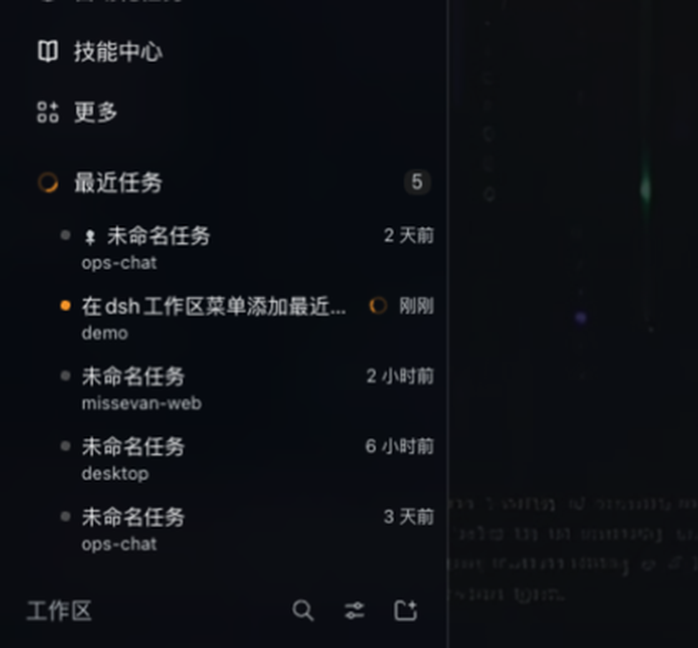
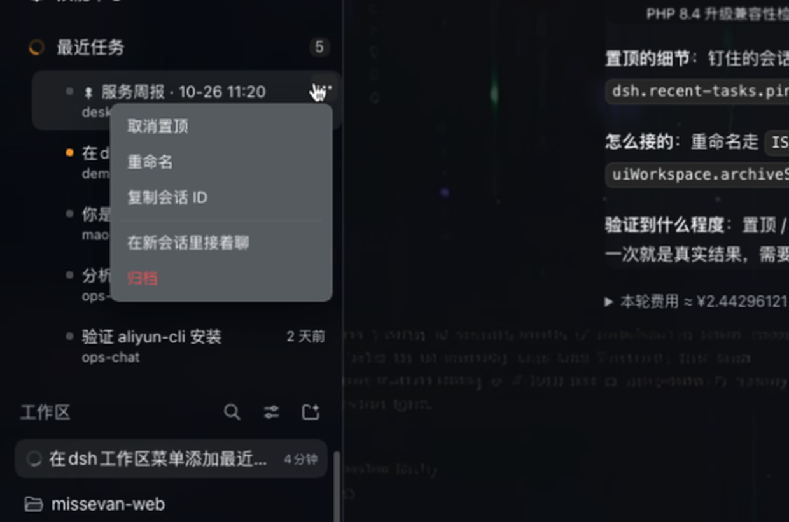
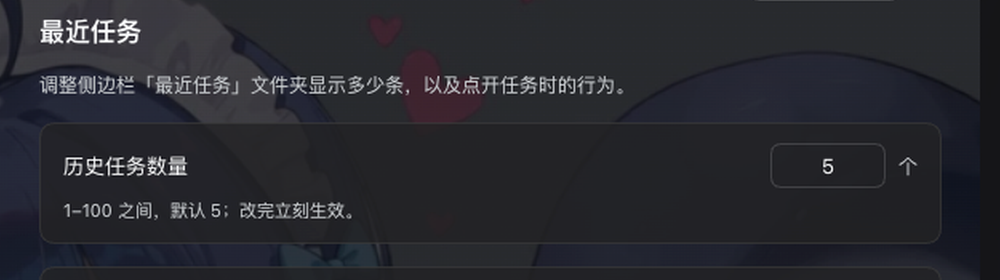

# dsh-recent-tasks

[中文](#中文) · English

A collapsible **Recent tasks** folder at the top of the sidebar in [DeepSeek Harness](https://github.com/deepseek-ai/deepseek-harness): the tasks you touched last, one click away — no scrolling the workspace tree to find "that conversation from an hour ago".



<p align="center"></p>

## Features

- **Folder at the top of the workspace area.** Sits directly above 工作区, collapsed by default, with a live count badge. Expanding it pushes the tree down, exactly like expanding a workspace folder.
- **Most recent first.** Shows the N most recently updated tasks (1–100, default 5); blank, archived and subagent sessions are filtered out.
- **Pin / favorite.** Pin the tasks you keep coming back to — pinned rows stay on top and ignore the recency order. Pins persist per browser profile.
- **Row menu.** Hover a row for a `⋯` button, or right-click it:

  

  | Item | What it does |
  | --- | --- |
  | 置顶 / 取消置顶 | Pin or unpin this task |
  | 重命名 | Inline edit, `Enter` to commit, `Esc` to cancel |
  | 复制会话 ID | Copy the session id |
  | 在新会话里接着聊 | Fork the session and switch to the fork |
  | 归档 | Archive the session (restorable from **Settings → 归档会话**) |

  The menu closes on `Esc`, on an outside click, and — when opened from `⋯` — as soon as the pointer leaves it.
- **Running state.** A running task gets an amber spinner instead of the state dot, and the folder icon itself spins while anything in the list is running. Rotation honours `prefers-reduced-motion`.
- **Click to locate.** Clicking a task switches to it *and* reveals it in the workspace tree: the owning group expands, the row scrolls into view and is highlighted. Turn it off in settings to only switch the main panel.
- **Settings page.** **Settings → 最近任务** (next to 皮肤 / 归档会话):

  

  History count (1–100), the reveal-on-click switch, and 恢复默认.
- **Theme-native.** Only `--dsw-alias-*` theme tokens and the app's own blue (`#7aaaff`, the send-button accent) are used, so it follows light/dark and custom skins. Chinese/English UI follows the app language.

## Install

```sh
dsh plugin --profile desktop add github:fishcg/dsh-recent-tasks
```

Then reload the app window (`Cmd+R` on macOS). The folder shows up above 工作区, and the plugin appears in **Settings → 插件** with its icon, title and description.

To remove it:

```sh
dsh plugin --profile desktop remove @fishcg/dsh-recent-tasks
```

## Settings

| Key | Default | Meaning |
| --- | --- | --- |
| `limit` | `5` | How many tasks the folder lists (1–100) |
| `reveal` | `true` | Also expand + scroll to the task in the workspace tree when clicked |

Stored in `localStorage` as `dsh.recent-tasks.settings.v1`; pins live in `dsh.recent-tasks.pins.v1`.

## How it works

The sidebar's workspace area is a single-occupancy slot owned by the shipped workspace browser, and it exposes no seat for extra groups. Rather than shadow that UI (which would break every plugin that plugs into it), this plugin:

1. mounts a zero-visual React component in the official `sidebar.footer.action` list slot,
2. creates one `div` as the first child of the sidebar's content column (`[class*="_regionArea"]`) and renders the folder into it through `ReactDOM.createPortal` — so the folder lives inside the real flex column, above 工作区, and expands inline,
3. reads session data from the slot's `useSessions` snapshot and acts through the public client services (`uiWorkspace.openSession / forkSession / archiveSession`, `sessions.retain(...).rename()`).

No DOM is written outside that container, no Harness client package is imported, and every registration goes through `ctx.slots.inject(...)` so it is torn down cleanly.

## Development

Plain JavaScript, no build step — the Client half is loaded as an ES module by DSH's module loader.

```
client.js            the whole UI (folder, rows, menu, settings page, CSS, dictionaries)
index.js             Host half, intentionally empty: there is nothing to serve
cordis.patch.yml     inserts the `recent-tasks` row into the profile
icon.svg             plugin icon (also rendered to assets/icon-180.png)
locale/{zh,en}.json  plugin-card title / description
docs/                README screenshots
```

Edit `client.js`, then `Cmd+R` in the app to reload the client bundle.

## License

MIT © 2026 fishcg

---

## 中文

侧边栏顶部多一个可折叠的 **最近任务** 文件夹：最近改动过的任务排在最前，点一下就回到那个会话，不用再在工作区列表里翻。

- **位置**：紧贴「工作区」上方，默认收起、右侧带数量徽标；展开时和展开一个工作区目录一样，下方内容顺势下移。
- **排序**：按更新时间从新到旧，只显示前 N 个（默认 5，可在 1–100 之间调），空会话、已归档、子智能体会话会被过滤掉。
- **置顶**：常用会话钉在最上面，不参与时间排序；置顶状态存在本机，重启后仍在。
- **行菜单**：鼠标悬停出现 `⋯`（右键同样可以），菜单项为 置顶/取消置顶、重命名（行内编辑，Enter 提交 / Esc 取消）、复制会话 ID、在新会话里接着聊（分叉并切换过去）、归档（可在 设置 → 归档会话 里恢复）。
- **运行状态**：正在运行的任务用琥珀色转圈代替状态点，文件夹图标在有条目运行时也会转（尊重系统的减少动态效果设置）。
- **点一下就定位**：切换会话的同时，在左侧展开它所属的分组、滚动到该行并高亮；不需要的话可以在设置里关掉，关掉后只切主面板。
- **设置**：**设置 → 最近任务**，可调历史任务数量、点任务是否定位到工作区、恢复默认。
- **主题**：只用 `--dsw-alias-*` 主题变量和应用自己的蓝色（`#7aaaff`），浅色/深色/第三方皮肤都会跟着变；中英文跟随应用语言。

安装：

```sh
dsh plugin --profile desktop add github:fishcg/dsh-recent-tasks
```

然后在窗口里按 `Cmd+R` 重新加载。卸载：`dsh plugin --profile desktop remove @fishcg/dsh-recent-tasks`。
